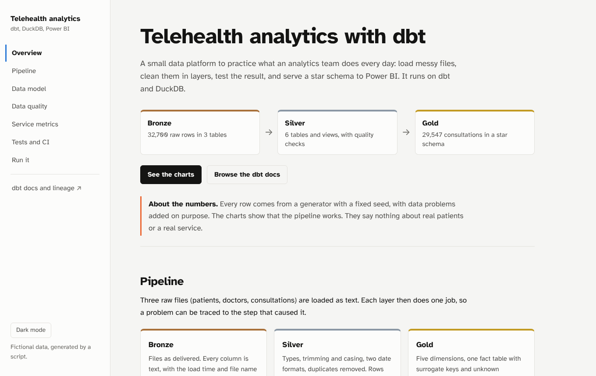
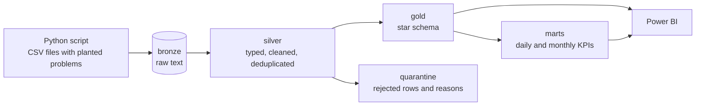
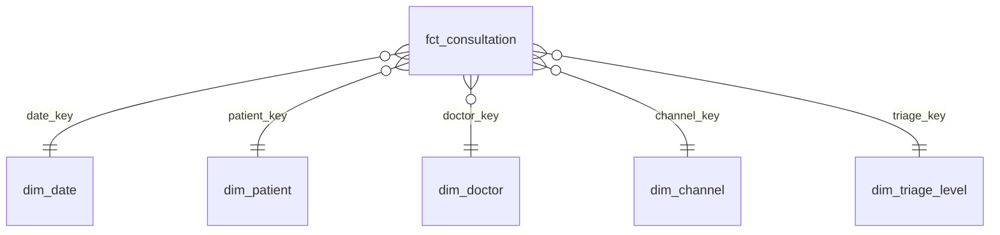

# Telehealth analytics with dbt



Live site with the charts, the data model and the dbt docs: https://YOUR_USER.github.io/telehealth-dbt-analytics/

This is a practice project. I wanted one place where I could show how I work with data from raw files to a reporting model: loading messy sources, cleaning them in layers, testing the result and serving a star schema to Power BI. It runs on dbt and DuckDB, so anyone can clone it and run it without an account or a cloud bill.

The domain is a fictional telemedicine service. All data comes from a script with a fixed seed. No real patient, doctor or company is involved.

## How it flows



| Layer | What happens |
|---|---|
| bronze | Files loaded as they are, every column as text, with load time and file name. |
| silver | Types, trimming and casing, two date formats, duplicates removed. Rows that break a rule are flagged. |
| gold | Five dimensions and one fact table with surrogate keys and an unknown member in each dimension. |
| marts | Two small reporting tables built on the fact table. |

## Data model



The grain of the fact table is one row per valid consultation.

A few choices worth knowing about:

- Surrogate keys are an md5 hash of the business key (`macros/keys.sql`), so they do not change between runs.
- Every dimension has a `-1` row. A consultation that points to a patient we never received is kept and linked to it. Dropping it would hide a data problem, and a left join would leave a null key in the fact.
- Invalid consultations (they end before they start, or start before they were requested) are not deleted. They go to `silver.dq_rejected_consultations` with the reason.
- `silver.dq_reconciliation` follows the rows from bronze to gold. With the default seed: 30,600 rows delivered, 600 duplicates removed, 453 rejected, 29,547 in the fact table, 0 unexplained.

## Tests

`dbt build` runs 58 data tests and 2 unit tests.

- generic tests (`unique`, `not_null`, `accepted_values`) and a `relationships` test from the fact table to each dimension
- two custom generic tests in `tests/generic`, `non_negative` and `value_between`
- two singular tests in `tests/`
- unit tests in `models/silver/_unit_tests.yml`, which run the cleaning logic on small hand-written inputs
- the source test on duplicate consultation ids is set to `warn`. The duplicates are in the raw data on purpose, so dbt reports 600 rows and the build still passes.

## Run it

You need Python 3.10 or newer.

```bash
python -m venv .venv && source .venv/bin/activate
pip install -r requirements.txt

make site      # generate data, dbt build, export site data, dbt docs
make serve     # open http://localhost:8000
```

Other targets: `make data`, `make build`, `make export` (CSV and Parquet files of the gold tables, for Power BI) and `make clean`.

To get a bigger dataset: `python ingestion/generate_and_load.py --consultations 100000 --seed 7`.

## Publishing the site

The workflow in `.github/workflows/ci.yml` builds everything on each push and publishes the `site` folder with GitHub Pages. In the repository settings, under Pages, set the source to GitHub Actions. Pull requests run the build and the tests but do not publish.

## Layout

```
ingestion/         generate the CSV files and load bronze
models/silver/     staging models, quarantine, reconciliation, unit tests
models/gold/       dimensions and fact table
models/marts/      KPI tables
macros/            surrogate keys, schema naming
seeds/             triage levels
tests/             singular and generic tests
scripts/           export of gold tables, export of site data
site/              the project site (plain HTML, CSS and JavaScript)
docs/powerbi.md    relationships and DAX measures for a Power BI model
```

## Power BI

There is no `.pbix` file in the repository. `docs/powerbi.md` describes the relationships and the DAX measures I would put on top of the gold layer.

## Limits

- Everything runs on DuckDB on one machine. There is no Azure, Databricks or Data Factory in this project.
- No streaming and no incremental models. Terraform is not used either.
- The data is random, so the charts show that the pipeline works and not anything about real care.

## What I would do next

- Run the same models on Databricks with the `dbt-databricks` adapter, with bronze as Delta tables.
- Orchestrate the ingestion with Azure Data Factory.
- Make the fact table incremental and add source freshness checks.
- Track changes on doctors with a dbt snapshot (slowly changing dimension, type 2).

## Licence

MIT, see `LICENSE`. The site uses Chart.js (MIT) and the Atkinson Hyperlegible fonts (SIL Open Font License), both included in `site/`.
